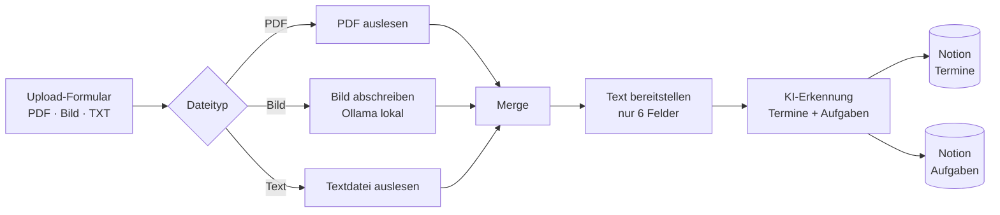
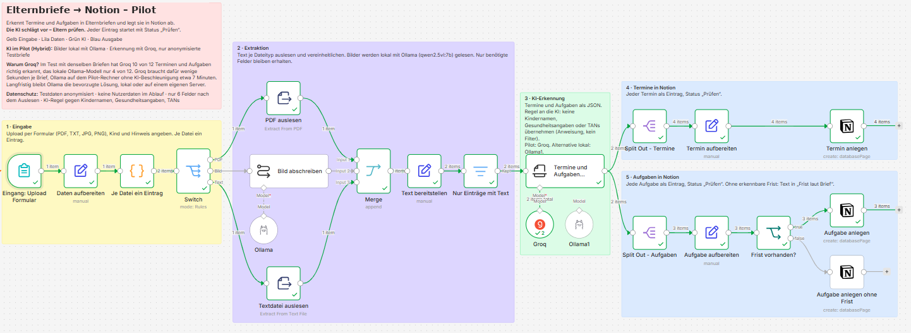
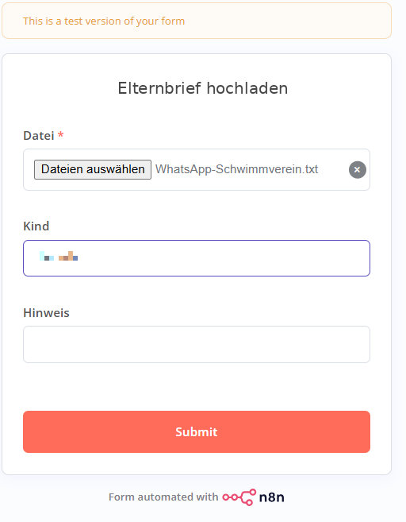
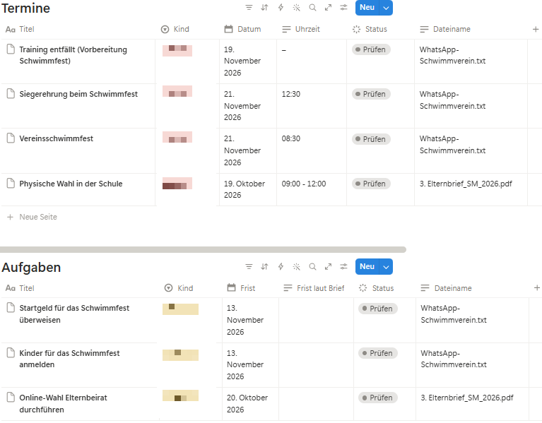

# n8n-elternbriefe-notion

KI-Workflow in n8n, der Elternbriefe aus Schule, Kita und Verein ausliest und daraus Termine und Aufgaben in Notion anlegt.

Entstanden als Pilotprojekt für die IHK-Prüfung **KI-Integration Manager** (November 2026).

> **Grundsatz: Die KI schlägt vor – Eltern prüfen.**
> Jeder erkannte Eintrag landet mit Status „Prüfen“ in Notion. Die KI-Erkennung ersetzt nicht die menschliche Kontrolle.

---

## Problem

Eltern erhalten Informationen über viele Kanäle: Elternbriefe als PDF, Fotos von Aushängen, Mitteilungen der Schul-App, Nachrichten in Eltern- und Vereinschats. Termine und Fristen gehen darin leicht unter.

## Lösung im Pilot

Ein Upload-Formular nimmt Briefe entgegen. Der Workflow liest den Text aus, lässt eine KI Termine und Aufgaben erkennen und legt sie strukturiert in zwei Notion-Datenbanken ab.

**Eingang:** Upload-Formular für PDF, Bilder (JPG, PNG) und Textdateien. WhatsApp-Chat-Exporte (.txt) laufen ohne Anpassung über den Text-Zweig.

**Ausgabe:** Notion-Datenbanken „Termine“ und „Aufgaben“, jeder Eintrag mit Status „Prüfen“.

### Screenshots

Workflow in n8n:

Upload-Formular:

Ergebnis in Notion (Testlauf mit einem Elternbrief als PDF und einem WhatsApp-Export; Kindernamen unkenntlich gemacht):

## KI im Pilot: Hybrid

| Schritt | Modell | Wo |
|---|---|---|
| Bild abschreiben | `qwen2.5vl:7b` über Ollama | lokal |
| Termine und Aufgaben erkennen | `openai/gpt-oss-120b` über Groq | Cloud, nur mit anonymisierten Testbriefen |
| Alternative Erkennung | `llama3.2` über Ollama (im Workflow enthalten, nicht verbunden) | lokal |

**Warum Hybrid?** Ergebnis des Modellvergleichs mit denselben Testbriefen, gleichem Prompt und gleichem Schema:

| | Ollama llama3.2 (lokal, nur CPU) | Groq gpt-oss-120b (Cloud) |
|---|---|---|
| Langer Infobrief, Soll-Einträge getroffen | 4 von 12 | 10 von 12 |
| Erfundene Inhalte | vereinzelt | keine |
| Laufzeit KI-Erkennung | ca. 7 Minuten | wenige Sekunden |
| Daten verlassen den Rechner | nein | ja |

Pilot-Rechner: Intel i7-8650U, 16 GB RAM, keine KI-Beschleunigung. Die lokale Variante bleibt das bevorzugte Zielsystem, braucht aber geeignete Hardware.

## Privacy by Design

| Nr. | Maßnahme |
|---|---|
| P1 | Bilder werden lokal abgeschrieben; Cloud-KI nur mit anonymisierten Testbriefen |
| P2 | Formular nur für angemeldete n8n-Nutzer |
| P3 | Keine Nutzerdaten im Ablauf („Include User in Output“ aus) |
| P4 | Nach dem Auslesen nur 6 Felder; Originaldatei und PDF-Metadaten werden verworfen |
| P5 | Anweisung an die KI: keine Kindernamen, Gesundheitsangaben oder Zugangsdaten übernehmen |
| P6 | Jeder Eintrag startet mit Status „Prüfen“ |

**Grenze:** P5 ist eine Anweisung, kein technischer Filter. Im Test mit einem Gruppenchat wurden Kindernamen trotzdem übernommen. Für einen Produktivbetrieb wäre eine technische Pseudonymisierung nötig.

## Learnings

**KI und Modelle**
- Kleine lokale Modelle liefern bei verschachteltem JSON-Schema oft ungültige Ausgaben. Schema vereinfachen und JSON-Ausgabe am Modell erzwingen hilft mehr als ein größeres Modell auf CPU.
- „Output Format JSON“ nur am Modell der Erkennung setzen. Am Bildmodell führte es zu leerem Text.
- Beispiele im Prompt übernimmt ein kleines Modell teils wörtlich. Neutrale Beispiele verwenden.
- Temperature 0.1 verhindert keine schwankenden Ergebnisse beim kleinen Modell.
- Prompt-Regeln zum Datenschutz sind kein Filter.
- Faire Modellvergleiche brauchen gleichen Prompt, gleiches Schema und gleiche Temperature.

**n8n**
- Auslese-Nodes geben Metadaten nicht weiter. Rückgriff per `$('Node').item.json`.
- Merge vor der KI, damit Folge-Nodes nur einmal je Upload laufen.
- Filter vor der KI statt Abbruch bei leerem Text.
- Pin Data für reproduzierbare Tests.

**Vorgehen**
- Zielkonflikt Datenschutz vs. Qualität mit Messwerten entscheiden, nicht nach Meinung.
- Scope bewusst klein halten (nur Upload, nur Notion), Erweiterungen als Ausblick führen.
- Menschliche Prüfung ist bei KI-Extraktion nicht optional.

## Grenzen des Pilots

- Testumfang: 9 anonymisierte Dateien. Für belastbare Quoten wären 20–30 Briefe nötig.
- Ergebnisse schwanken je Lauf in Anzahl und Zuschnitt der Einträge.
- Gruppenchats: Aufgaben anderer Personen werden teils übernommen, relative Angaben („bis Freitag“) teils falsch umgerechnet.
- Keine Word-Dateien (.docx), kein E-Mail-Eingang.

## Ausblick

- Lokale Verarbeitung auf Hardware mit KI-Beschleunigung
- Lokale Datenbank statt Notion
- E-Mail-Eingang und Zusammenfassung nach jedem Lauf
- Word-Dateien direkt verarbeiten

---

## Workflow selbst ausprobieren

**Voraussetzungen**
- n8n (selbst gehostet)
- Ollama mit den Modellen `qwen2.5vl:7b` und optional `llama3.2`
- Groq-API-Key (oder die lokale Alternative `Ollama1` verbinden)
- Notion-Integration mit Zugriff auf zwei Datenbanken

**Notion-Datenbanken anlegen**

| Datenbank | Eigenschaften (Name · Typ) |
|---|---|
| Termine | Titel · Title, Datum · Date, Uhrzeit · Text, Kind · Select, Dateiname · Text, Status · Status (Option „Prüfen“) |
| Aufgaben | Titel · Title, Frist · Date, Frist laut Brief · Text, Kind · Select, Dateiname · Text, Status · Status (Option „Prüfen“) |

**Import**
1. `workflow/n8n-elternbriefe-notion.json` in n8n importieren.
2. Zugangsdaten anlegen und zuordnen: Notion, Groq, Ollama. Im Export sind keine Zugangsdaten enthalten.
3. In den Nodes **Termin anlegen**, **Aufgabe anlegen** und **Aufgabe anlegen ohne Frist** die Platzhalter ersetzen:
   - `DEINE-TERMINE-DATENBANK-ID`
   - `DEINE-AUFGABEN-DATENBANK-ID`
4. Formular über die Test-URL des Nodes **Eingang: Upload Formular** öffnen und einen Brief hochladen.

**Hinweis zum Prompt:** Der Workflow enthält einen Basis-Prompt für die KI-Erkennung. Der im Pilot getestete Prompt enthält weitere Regeln und ist nicht Teil dieses Repos. Die Testergebnisse oben beziehen sich auf den vollständigen Prompt.

## Rechte

© 2026 Gundula-automates. Alle Rechte vorbehalten.
Der Code ist zur Ansicht veröffentlicht. Eine Nutzung, Weitergabe oder Veränderung über das private Ausprobieren hinaus ist ohne Zustimmung nicht gestattet.
